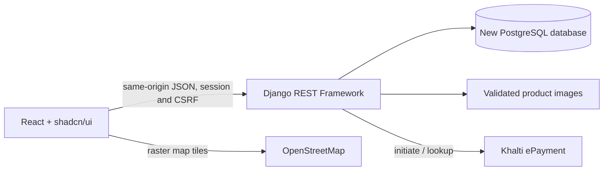
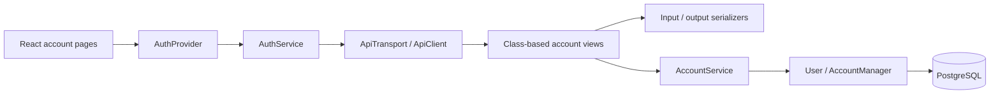

# Independent SportHub architecture

The browser runs React and TypeScript. All runtime data comes from Django REST Framework at `/api/`. Vite proxies `/api/` and `/media/` during development; Nginx handles the same paths in deployment. Django persists only to the newly created PostgreSQL database. PHP, Apache, PDO, MySQL, Swiper and Font Awesome are not dependencies of the new runtime.

## Domain boundaries

`accounts` owns identity, staff permissions, password validation and sessions. `catalog` owns categories, products, images, discounts and featured limits. `commerce` owns cart, wishlist, selected checkout, inventory reservations, immutable order lines and payment ledgers. `support` owns contact messages. `outlets` owns outlets, routing intersections and undirected road segments. Class-based HTTP views delegate transactional work to domain service objects.

## Object-oriented design

Keep responsibilities small and explicit as the migration continues:

- **Models and managers** own persisted entities, constraints and entity-specific behavior. `User` extends Django's `AbstractUser`; `AccountManager` normalizes email. `Product.price` and `Product.stock_status` encapsulate derived product state.
- **Serializers** define accepted input and public output. `IdentitySerializer` shares contact validation between registration and profile updates. `StrictSerializer` rejects unknown fields, and `UserSerializer` exposes only public account fields.
- **Services** own use cases and transactional boundaries. `AccountService` handles registration, sign-in/out, profile updates and password changes, with internal helpers for password policy and database conflicts. Future catalog, checkout and payment workflows should follow this pattern instead of accumulating logic in views.
- **Views and policies** use focused inheritance. `AccountView` supplies an injectable `service_class` and disables response caching; concrete views coordinate validation and responses. `CsrfSessionAuthentication`, `CaseInsensitiveAccountBackend` and `SpecialCharacterPasswordValidator` implement framework policy interfaces. Staff authorization remains enforced by API permissions.
- **Frontend services** use composition. `AuthService` depends on the `ApiTransport` interface; `ApiClient` implements transport, CSRF and error handling. A different transport can be supplied without rewriting account behavior. The client keeps CSRF request state private and accepts an injectable fetch implementation.
- **React components** remain functional components with hooks. The provider owns current-session UI state; pages use service methods. OOP applies to domain and infrastructure responsibilities. Presentation does not need class components or a generic repository layer over Django's ORM.

Avoid one large service for unrelated domains, global mutable user state, and inheritance without shared behavior. Use interfaces or protocols when an integration needs interchangeable implementations. Keep pure functions for small stateless calculations and formatting.

## Identity lifecycle

Customer login uses case-insensitive email; staff can use case-insensitive username. Registration generates a customer username and never accepts role flags. Session and CSRF cookies are HttpOnly; `ApiClient` obtains a fresh masked CSRF token before mutations, including after login or a password change. Only simultaneous token requests are coalesced. Anonymous unsafe requests also pass through CSRF validation.

Registration and login establish Django sessions. Changing a password verifies the old password, validates the new one against the user's identity, and retains the current session while invalidating other sessions. Identity uniqueness is checked by validation and database constraints; concurrent conflicts return field errors. React guards improve navigation; `/api/admin/session/` independently checks staff permission on the server. Account responses are not cached.

## Data invariants

Identity is unique case-insensitively. Product/category names are unique case-insensitively. Prices are decimal NPR; provider amounts are integer paisa. Stock cannot be negative, discounts range from zero to 100, cart/reservation/order quantities are positive, and a cart or wishlist cannot contain duplicate products for an owner. Order items retain product descriptions/prices independently of future catalog edits. Physical map coordinates and ratings have explicit bounds. Edges cannot join a node to itself or duplicate the reverse of another undirected segment.

Cart and wishlist mutations always scope rows to the authenticated user. Selected checkout rejects missing, foreign, duplicate or unavailable lines and calculates totals on the server. Payments never trust callback query-string status or amounts. Each successful payment can be linked to only one order; provider verification and transactional row locking prevent duplicate fulfillment.

Implemented COD writes take the same PostgreSQL transaction advisory lock as catalog writes, then lock the account and affected cart/product rows. This serializes inventory-changing operations, including concurrent attempts to purchase the final unit, and prevents catalog updates/deletions racing checkout. It favors correctness for this application's workload; partitioning the lock for higher throughput requires preserving lock order across catalog, account deletion and payment workflows. Checkout creates the order/items, decrements stock and deletes selected cart rows in one transaction. Failure rolls back the whole operation. Staff account mutations use a separate transaction lock and recheck the acting staff account to protect concurrent staff deletion.

## Security boundaries

No old users, passwords, sessions or operational records are imported. No old database credentials are loaded. `backend/.env` is explicit; parent-directory dotenv discovery is disabled. Session cookies are HttpOnly, secure by default outside development, and use SameSite=Lax to support the external payment redirect. Every unsafe request, including anonymous registration/login/contact, requires CSRF validation. Staff permissions are checked by Django even when the frontend hides a control.

Uploads must be supported raster images within the original 2 MB size limit, with content validation and generated storage names. Production serves uploaded media as static files, not executable content. Deployment requires a strong secret, trusted host/origin lists, TLS, secure cookies, database backups and an actual Khalti merchant configuration.

## Fresh data

The new database starts without products, orders, customers or invented sales metrics. Staff create real catalog/outlet data through the application. Original static marketing content and illustrations are assets, not database migration. Legacy SQL sample outlets and street network are documented as examples and are not automatically inserted as live business records.
